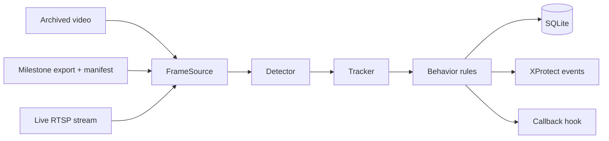

# System Overview

What AnimalUniversity does and how the parts fit. Read this before the code.

## Purpose

Watch zoo enclosures through Milestone XProtect cameras, track each animal,
recognise welfare-relevant behavior (first: pacing), store it with real-world
time, and raise events in XProtect.

## Flow

One loop (`animaluniversity.pipeline.run_pipeline`) serves all three sources.

## Parts

| Part | Where | Notes |
| --- | --- | --- |
| Sources | `animaluniversity/pipeline/sources.py` | File and export use video time and repeat exactly; live keeps only the newest frame |
| Milestone manifest | `animaluniversity/ingest/milestone.py` | Camera, enclosure, timezone-aware start and end |
| Detectors | `services/analytics/detector.py` | `YoloDetector` (trained weights, production) and `OpenVocabDetector` (species by name, bootstrap) |
| Trackers | `services/analytics/tracker.py` | `MotionTracker` (pipeline default), `IoUTracker` (used by the UI) |
| Behavior | `services/analytics/behavior.py` | `PacingAnalyzer` |
| Storage | `animaluniversity/pipeline/sinks.py` | Tables `runs`, `track_points`, `behavior_events` |
| Events | `services/eventbridge/event_sender.py` | AnalyticsEvent XML to the Event Server |
| Labeling | `animaluniversity/labeling/autolabel.py` | Archived footage to YOLO dataset |
| UI | `apps/ui_streamlit/` | Demo; Claude Code's area |

## Path to production

1. Archived clips with `--classes` (open-vocabulary) to see first results.
2. Hand-label pacing bouts on a few clips; score every change against them.
3. Auto-label archived footage, review, fine-tune a site model.
4. Run the same command on live streams with the fine-tuned weights.

## Glossary

- **Pacing:** repeated back-and-forth travel along one route. Rule: at least 4
  end-to-end trips within 20 s, route at least 1.5 body lengths, movement
  mostly along one line.
- **Open-vocabulary detection:** a detector prompted with class names instead
  of trained on them.
- **Pseudo-labels:** boxes produced by a model, used as training data after
  human spot-checks.
- **Frame source:** anything that yields frames with a timestamp.
- **`timestamp_s` / `wall_time`:** seconds since the source started (used for
  behavior timing) / real-world timezone-aware time (stored, sent to XProtect).
